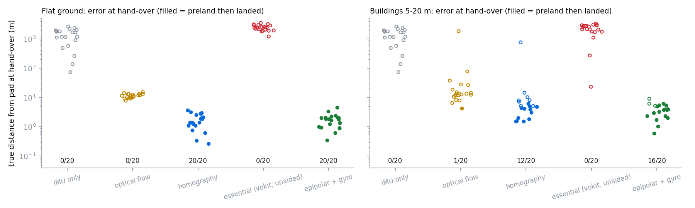
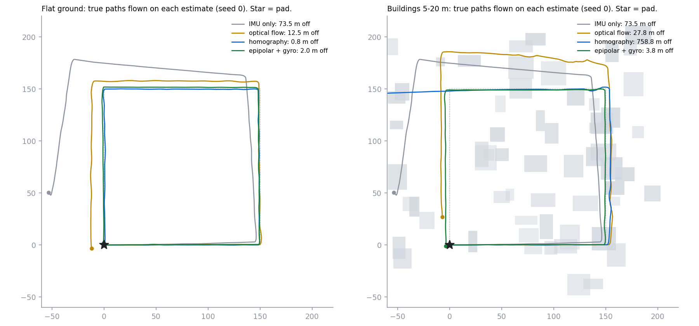

# gps-free-drone

A multirotor takes off over a landing pad, flies a 600 m loop at 40 m with no
GPS, comes back to where it believes the pad is, and lands on it with a
fiducial marker. Its position comes only from an IMU, a downward camera and a
downward rangefinder.

This repository is the integration of three earlier ones. It measures which
way of turning downward images into motion actually gets the aircraft home.


This is a simulation study. There is no aircraft, camera or flight
controller behind these numbers. Images are not rendered: the camera is
modelled as projected landmarks with pixel noise and wrong matches.

---

## What comes from where

| stage | code | source |
|---|---|---|
| horizontal flight control (position → velocity → attitude → rate) | `dctk.cascade.MultirotorCascade`, unchanged, on the per-axis attitude plant from dctk's own tests | [drone-control-toolkit](https://github.com/Pratyush150/drone-control-toolkit) `@ec49130`, pip dependency |
| landing on the pad | `preland.run_episode`, the *concurrent* strategy that study recommends, started from the true error the navigation left | [precision-landing](https://github.com/Pratyush150/precision-landing) `@20358e0`, pip dependency |
| 8-point essential matrix, cheirality, Sampson error, triangulation | `vokit/vo/geometry.py`, vendored unchanged into [`src/gpsfree/vendor/`](src/gpsfree/vendor/) | [monocular-visual-odometry](https://github.com/Pratyush150/monocular-visual-odometry) `@7ab552a`; vendored because the `vokit` package pins OpenCV and only this pure-NumPy file is needed |
| terrain, downward camera, rangefinder, the four VO front-ends, navigation EKF, mission loop | new here | this repository |

`preland` samples its own hand-over offset inside `run_episode`. To start
from the offset the navigation actually produced, `mission._handover_at`
replaces `preland.episode.initial_state` for the duration of one call and
restores it afterwards. Everything else in the landing is preland's own
code, unmodified.

---

## Result



Each method flew 20 seeded sorties per terrain. A sortie is a 150 m square at
40 m, 600 m in all, in 3 m/s wind with gusts. The accelerometer has a
random 0.05 m/s² bias. Afterwards, `preland` attempts the landing from the
true hand-over error. Full table: [`docs/benchmark.txt`](docs/benchmark.txt).

| navigation | flat: error at hand-over (median / p90) | flat: landed | buildings: error (median / p90) | buildings: landed |
|---|---:|---:|---:|---:|
| IMU only | 1,428 m / 2,204 m | 0/20 | 1,428 m / 2,204 m | 0/20 |
| optical flow + rangefinder | 11.3 m / 13.5 m | 0/20 | 13.5 m / 41.6 m | 1/20 |
| homography + gyro + rangefinder | **1.4 m** / 3.0 m | **20/20** | 5.0 m / 10.7 m | 12/20 |
| essential matrix (vokit, unaided) | diverges | 0/20 | diverges | 0/20 |
| **epipolar + gyro + rangefinder** | 1.8 m / 2.5 m | **20/20** | **3.9 m / 6.2 m** | **16/20** |

The buildings are 5–20 m boxes covering roughly a third of the area, seen
from 40 m.



What each row means:

- **IMU only.** Integrating a 0.05 m/s² bias is ½·b·t², several hundred
  metres over two minutes. The numbers match that. Only 5 of 20 sorties even
  believed they had reached home. This row is the reason the rest exist.
- **Optical flow** is how PX4Flow-class sensors work. It takes the
  de-rotated flow in the central window, scaled by the rangefinder distance
  and corrected for tilt. Its per-second velocity error is small (median
  0.19 m/s), but it consistently reads distance a few percent short. You can
  see this in the paths figure: the square it flies is too large. That
  integrates to an 11 m miss. The source of this bias was not isolated.
- **Homography** is exact for a flat floor. Over flat ground it is the best
  method here: median 1.4 m after 600 m, a 0.24 % drift. Over buildings, the
  plane it assumes no longer exists. The rangefinder sometimes hits a roof
  while most features are on the ground, so it produces a heavy tail. On
  seed 0 a run of bad frames pulled the filter away and the aircraft ended
  759 m off (right panel, blue).
- **Essential matrix, unaided.** This is the `vokit` pipeline that works on
  KITTI's forward-looking car camera. Looking down from 40 m it fails in
  two distinct ways, both well known and both reproduced in the tests:
  - **Plane degeneracy.** Over flat ground, the 8-point essential matrix is
    undetermined, even with zero noise. Over buildings, a RANSAC sample of
    eight ground points still yields an E that fits the whole ground plane,
    and wins the vote.
  - **Rotation–translation ambiguity.** With a narrow downward view, a 0.5°
    rotation error looks almost exactly like a translation. At 0.5 px of
    noise, the recovered direction of travel is off by about 11°. The velocity
    error is about 4 m/s, and the filter's outlier gate rejects nearly
    everything.
- **Epipolar + gyro** keeps vokit's epipolar machinery: Sampson error,
  cheirality, triangulation. But it takes the rotation from the gyro instead
  of estimating it. With R known, the translation direction is a linear
  2-point problem, and both failures above disappear. A plane no longer
  makes it degenerate. Over flat ground it is as good as homography (1.8 m
  vs 1.4 m). Over buildings it is the best and has the lightest tail
  (p90 6.2 m vs 10.7 m).

**The landing makes the navigation number concrete.** `preland` starts its
descent at 6 m. Across all 200 sorties:

| hand-over error | sorties | landed |
|---|---:|---:|
| under 4 m | 57 | 57 |
| 4–7 m | 18 | 12 |
| over 7 m | 125 | 0 |

So for this aircraft, good-enough GPS-free navigation means **under about
4 m after 600 m, roughly 0.7 % drift**. Over flat ground, both gyro-aided
geometric methods meet that every time. Over buildings, epipolar + gyro has
its median right on that line (3.9 m), and nothing else comes close.

---

## How the loop runs

- **Flight dynamics: 250 Hz.** Per horizontal axis, `dctk`'s cascade drives
  rate, attitude and translation, with quadratic drag against wind plus an
  Ornstein–Uhlenbeck gust.
- **Navigation filter: 50 Hz prediction.** Six states: position, velocity
  and accelerometer bias. Predicted from the biased accelerometer, updated
  with VO velocity, gated at χ²(2) 99 %.
- **Camera: 10 Hz.** Each VO method compares keyframes 1 s apart. Epipolar
  methods need that parallax: 0.5 m of baseline from 40 m drowns in 0.5 px
  of noise. All methods use the same baseline to keep the comparison fair.
  Inputs per comparison:
  - up to 120 matched landmarks with 0.5 px noise and 5 % wrong matches
  - the gyro's relative rotation, with about 0.01° of error
  - a rangefinder that ray-casts along the tilted body axis to whichever
    surface it hits first
- **Navigation output drives the controllers.** The cascade is fed the
  estimated position and velocity, never the true ones. The aircraft flies
  wherever its estimate says the route is. That is why a navigation error
  is also a path error in the figure.

## Bugs found on the way

Each of these first showed up as one VO method looking far better or worse
than it should.

1. **Gyro error was 10× too large.** Per-frame rotation error of 0.002 rad
   becomes 8 cm of apparent motion at 40 m, a fake 0.8 m/s. A MEMS gyro over
   0.1 s is nearer 2×10⁻⁴ rad.
2. **The rangefinder pointed straight down; the camera did not.** At 0.3 rad
   of tilt the optical axis meets the ground about 12 m away from the point
   below the vehicle, often on a different surface. This broke the scale of
   every method over buildings until the rangefinder ray-cast along the body
   axis.
3. **The flow was 9 % short at 0.3 rad tilt.** That is exactly cos². With a
   tilted camera, horizontal motion has a component along the optical axis,
   and the first version discarded it.
4. **Unequal baselines.** Comparing flow and homography over 0.1 s with the
   epipolar methods over 1 s flattered the latter about tenfold.

## Limits

- No rendered images, no feature detector, no lighting, motion blur or
  rolling shutter.
- Altitude is held perfectly at 40 m, and the descent from 40 m to preland's
  6 m start is not flown. Any drift during it is not counted.
- Attitude is known except for the gyro error on relative rotation.
  `dctk.AttitudeEKF` exists but is not in this loop.
- The terrain is textured everywhere. Real featureless ground (water, snow,
  fresh tarmac) would starve every camera method.
- The navigation filter has no loop closure. On the way home it does not
  recognise where it took off. Recognising the pad's surroundings would
  remove the drift, and is the obvious next step.
- No PX4, MAVLink or ROS 2. `px4-mavlink-companion` is the repository that
  would carry this onto a real flight controller. It is not wired in here.

## Running it

```bash
python -m pip install --upgrade pip          # Ubuntu's pip 22.0 cannot install the git dependencies
pip install -r requirements.txt
pytest -q
python examples/benchmark.py --seeds 20      # about 15 minutes on 8 cores
python examples/make_figures.py
```

## License

MIT
